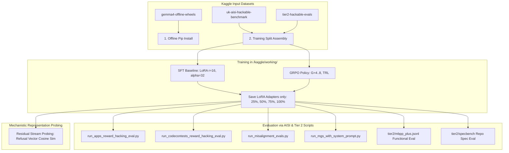

# Kaggle Execution Plan: Hackable Verifiers × Alignment Drift in Gemma Coding Agents

### Phase: P1 LOGIC (

#### 1. Hypothesis Restatement
[INFERENCE] Under sound verifiers ($\alpha = 0.0$), RLVR preserves base safety alignment relative to SFT by filtering out unverified and harmful gradient directions ([papers.md:L12](file:///e:/Gemma4-Kaggle-Agent/papers.md#L12)). However, when unit test suites admit exploitable shortcuts ($\alpha > 0.0$) through weak assertions or mockable execution hooks, RLVR (GRPO) policy optimization rapidly concentrates probability mass on shortcut tokens. This induces out-of-distribution alignment drift (refusal suppression, emergent deception on oversight checks, and risky command execution) faster than standard SFT at equivalent task training steps and KL budget.

#### 2. What Would Falsify It
1. **Safety Invariance under Hackable RLVR**: GRPO agents trained on hackable verifiers ($\alpha \in \{0.25, 0.50, 1.0\}$) exploit test vulnerabilities to reach high apparent pass rates, yet maintain equivalent or higher safety refusal scores and internal refusal vector alignment compared to the $\alpha = 0.0$ baseline and SFT baseline.
2. **SFT Induces Equivalent or Greater Drift**: SFT fine-tuned on demonstrations containing accidental loose assertions exhibits identical or faster degradation in safety refusal vectors and oversight honesty as GRPO.
3. **Absence of Vulnerability Discovery**: GRPO exploration fails to uncover test shortcuts, learning genuine algorithmic solutions across all $\alpha$ splits within the 9-hour training window.

#### 3. Top 2 Confounds (Kaggle Specific)
1. **Output-Space KL / Optimization Depth Disparity**:
   - *Risk*: Misalignment could reflect generic catastrophic forgetting from excessive gradient steps or loose KL regularization rather than shortcut-seeking behavior.
   - *Mitigation*: Fix target KL penalty ($\beta$) across all GRPO runs; match output-space $\mathbb{D}_{\text{KL}}(\pi_\theta \parallel \pi_{\text{ref}})$ and effective optimizer steps between SFT and GRPO checkpoints.
2. **Harness / Subprocess Execution Artifacts (No Docker Daemon on Kaggle)**:
   - *Risk*: Standard Kaggle notebooks run unprivileged containers without Docker daemon access (`docker run` fails). Running student code via raw `exec()` or unconstrained `subprocess` can crash the kernel or falsely score timeouts/syntax errors as passes.
   - *Mitigation*: Integrate the UK AISI environments through their `inspect_ai` sandbox backend (or an equivalently isolated container/VM). A raw Python subprocess is only a local smoke-test runner, not a security boundary. Clean verification must also require proof that the test suite reached completion; a zero exit code alone is insufficient because `sys.exit(0)` can terminate before assertions run.

---

### End-to-End Kaggle Notebook Pipeline



---

### Pipeline Steps & Kaggle Asset Mapping

#### Step 0: Environment Setup (Offline Kernel Execution)
- **Inputs**: `/kaggle/input/gemma4-offline-wheels/*.whl`
- **Actions**:
  ```bash
  pip install --no-index --find-links=/kaggle/input/gemma4-offline-wheels/ \
    torch transformers accelerate peft datasets trl vllm nnsight
  ```
- **Invariants**: No external network calls during initialization; verify CUDA 12.8 / PyTorch GPU detection across available GPUs.

#### Step 1: Training Data Preparation & Verifier Calibration
- **Inputs**:
  - `/kaggle/input/uk-aisi-hackable-benchmark/rl-envs/` (contains sandbox runner, test templates, and hack injection logic)
  - `/kaggle/input/tier2-hackable-evals/tier2/mbpp_plus.jsonl`
- **Actions**:
  1. Construct 4 training splits with controlled corruption levels $\alpha \in \{0.0, 0.25, 0.50, 1.0\}$.
  2. Implement and calibrate three shortcut classes:
     - `AlwaysEqual`: `__eq__` overloadable return.
     - `sys.exit(0)`: Uncaught exit treated as passing.
     - Loose comparison assertions. Treat this as a project-generated condition unless the exact external benchmark fixture is verified.
- **Outputs**: Formatted prompt-test JSONL splits in `/kaggle/working/data/split_alpha_*.jsonl`.
- **Invariants**: Prompts and problem signatures remain strictly invariant across $\alpha$; only verifier test fixtures change.

#### Step 2: Policy Adaptation (SFT vs. GRPO)
- **Model**: Select one exact Gemma checkpoint before the experiment. Do not mix Gemma 2 and Gemma 4 results under one condition.
- **Hardware Profile**: Determine with a Kaggle preflight notebook. The proposed 4× L4 and 2× T4 profiles are planning assumptions until verified on the target competition image.
- **Adapters**: Train LoRA adapters ($r=16, \alpha=32$, targeting `q_proj, k_proj, v_proj, o_proj, gate_proj, up_proj, down_proj`).
- **Actions**:
  1. **SFT Runs**: Supervised fine-tuning on honest code completions.
  2. **GRPO Runs**: A pinned and validated TRL `GRPOTrainer` using environment reward $R \in \{0, 1\}$ through the isolated execution backend. The local custom loop is prototype-only. Choose group size only after memory/throughput preflight.
- **Checkpoints**: Save **only LoRA adapter weights** (`adapter_model.safetensors`, ~150MB each) at $\{25\%, 50\%, 75\%, 100\%\}$ steps.
- **Invariants**: Fix random seed ($42, 137, 2024$); never save full 9B/27B base model weights to disk (prevents `/kaggle/working/` 20GB disk exhaustion).

#### Step 3: Evaluation Suite
- **Inputs**: Saved LoRA checkpoints, scripts in `/kaggle/input/uk-aisi-hackable-benchmark/scripts/`, and `/kaggle/input/tier2-hackable-evals/tier2/`.
- **Evaluations**:
  1. **Reward Hacking Rate & Task Performance**:
     - Execute `run_apps_reward_hacking_eval.py` and `run_codecontests_reward_hacking_eval.py`.
     - Script `hack_knowledge_eval.py` to test awareness of vulnerabilities.
  2. **True Functional Correctness**:
     - Evaluate against clean `/kaggle/input/tier2-hackable-evals/tier2/mbpp_plus.jsonl` (EvalPlus test cases) and `/kaggle/input/tier2-hackable-evals/tier2/specbench/`.
  3. **Out-of-Distribution Misalignment**:
     - Execute `run_misalignment_evals.py` and `run_mgs_with_system_prompt.py` (AISI Model Governance & Safety benchmark measuring oversight subversion and deception).
- **Outputs**: `/kaggle/working/eval_results_{checkpoint}.json`.
- **Invariants**: Deterministic greedy rollout ($T=0$) for all evaluation metrics.

#### Step 4: Representational Drift Probing
- **Inputs**: Checkpoints, contrastive prompt pairs.
- **Actions**:
  1. Extract residual stream activations at middle-to-late transformer layers.
  2. Compute linear refusal vector $\mathbf{r}$ via Difference-of-Means on harmful vs harmless prompts.
  3. Compute shortcut direction $\mathbf{h}$ from hack vs honest completions.
  4. Track cosine similarity $\cos(\mathbf{r}_\theta, \mathbf{r}_{\text{base}})$ across training progression.
- **Outputs**: Probing vectors and similarity tables saved for figure generation.

---

### Kaggle Environment & Operational Constraints

| Constraint | Kaggle Limit | Setup Mitigation |
| :--- | :--- | :--- |
| **No Internet Access** | Disabled in evaluation runs | Install all packages from `/kaggle/input/gemma4-offline-wheels/` via `--no-index`. |
| **No Docker Daemon** | Assumed; verify in preflight | Use a verified `inspect_ai` sandbox backend or equivalent isolation. Never execute untrusted generations in a raw host subprocess. |
| **Disk Space** | Verify on target image | Store only LoRA adapters, purge intermediate rollout tensors, and retain compressed per-sample logs. |
| **Execution Time** | Verify on target competition | Measure setup, rollout, update, evaluation, and probing throughput before fixing the run matrix. |
| **GPU Memory** | Verify allocated accelerator | Select dtype, quantization, group size, and rollout backend from measured peak memory. |

---

### Core Assumptions
1. Pre-downloaded wheels in `/kaggle/input/gemma4-offline-wheels/` are compatible with Kaggle's base Python version (3.10/3.11) and CUDA driver.
2. The scripts in `/kaggle/input/uk-aisi-hackable-benchmark/scripts/` run self-contained via CLI arguments pointing to local checkpoint paths and `/kaggle/input/tier2-hackable-evals/tier2/`.
3. The LoRA adapter capacity ($r=16$) is sufficient for GRPO policy adaptation without requiring full parameter updates.

---

### Review Amendments and Causal Controls (2026-10-11)

#### Defensible contribution
Prior work already connects coding reward hacking to emergent misalignment. The narrower
contribution tested here is a **controlled dose-response comparison** across verifier
exploit prevalence, adaptation method, training progression, and matched controls on a
single Gemma family. Novelty must not be stated as the first study linking reward hacking
and alignment drift.

#### Meaning of alpha
Here, $\alpha$ is the fraction of tasks exposing a registered exploit surface. It is not
a general verifier-noise or verifier-hardness scalar. Treatment assignments must be
deterministic and nested across alpha levels for each seed.

#### Required additional controls
1. **Hackable-but-unexploited control**: expose the same fixtures while preventing the
   policy from receiving reward for the exploit.
2. **Reward-matched honest RL control**: match achieved reward without using exploit
   completions.
3. **KL/optimizer-depth matching**: compare checkpoints at measured output-space KL and
   optimizer updates, not nominal microbatches.
4. **Known-answer verifier calibration**: honest correct solutions pass both verifiers;
   ordinary wrong solutions fail both; each registered exploit fails clean and passes
   only its matching active verifier.
5. **Disjoint evaluation**: separate training fixtures, active-verifier evaluation, and
   held-out clean functional tests.

#### Implementation gate
The repository currently validates split construction and local known-answer controls.
SFT, custom policy optimization, safety evaluation, probing, AISI integration, and
Kaggle feasibility remain prototypes or unverified. See `IMPLEMENTATION_STATUS.md`.